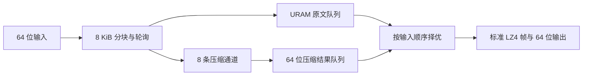

# 多算法 KU5P 框架

同一套 XDMA、AXI-Lite、长度/TLAST、计数与 EOP packetizer，按构建 profile
替换压缩核。一个镜像一种算法，整卡通过 JTAG 切换。主机协议与操作命令见
[固件指导](../README.md)。生成文件放在独立构建目录，原 PCIe 工程和 Vitis
库都保持不变。

| Profile | 算法 ID | 核数 | 压缩核时钟 | 引擎 |
| --- | --- | --- | --- | --- |
| raw | 1 | 4 | 250 MHz | 双寄存缓冲透传 |
| gzip | 2 | 4 | 250 MHz | 已验证的 8 lane、8 KiB gzip IP |
| lz4 | 3 | 4 | 250 MHz | 每引擎 8 条 LZ77 通道，标准独立块帧 |
| zstd | 4 | 2 | 125 MHz | 每引擎 4 条 LZ77 通道，经 AXI FIFO 与 250 MHz shell 交互 |
| minlz | 5 | 4 | 250 MHz | 每引擎 4 条 64 位匹配通道，16 KiB 独立块、CRC32C 和 EOF |

KU5P 的 gzip profile 已使用全部 64 个 URAM。按镜像替换允许每种引擎独立使用
资源。表中核数为主机看到的 DMA 引擎数；内部通道把独立小块并行编码，
不会新增 XDMA 设备。当前 HLS 估算为每个 LZ4 引擎 112 BRAM18K、10 URAM，
每个 Zstd 引擎 255 BRAM18K、26 URAM。Zstd 关键路径估算约 153 MHz，
采用 2 个引擎、125 MHz。HLS 估算与完整工程的实际资源不同；表中的频率是
配置值，镜像必须实际布线并通过 setup、hold 和 DRC 检查才能装载。

LZ4 以 8 KiB 块轮询分配到 8 条通道。读入、编码和按输入顺序写出并行执行；
原文放在 URAM 队列，尝试编码在每条通道打包为 64 位队列。两份数据同时排出，
压缩后不变小时选择标准原始块。编码器使用一个字典候选和 4 KiB 匹配扩展窗口，
长度不超过 72 字节时直接发原始块。改变并行度和编码参数后需要同时比较吞吐与压缩比。



Zstd 使用 8 KiB 块，每引擎把输入分配到 4 条 LZ77 通道，后续共享树生成与
FSE 阶段，输出标准 Zstd 帧。两种算法的吞吐需要各自实测，不能套用 gzip 指标。

## 依赖

- Vivado / Vitis HLS 2025.2，器件 `xcku5p-ffvb676-2-e`。
- 本机已验证的四通道 XDMA 工程完整副本、gzip IP 仓库和路由参考 DCP。
  `build.sh` 依赖工程文件 `qz01_compress_4ip_8k8lane_ml2_bramfifo.xpr`。
- Vitis Libraries revision `f217398d03b018c2774816200e562750872d9c31`。
  构建需要 `data_compression/L1/include/hw`、`security/L1/include`。
  该源码目录名虽含 `2021.1`，实际内容以 revision 为准。
- 已验证的 XDMA EOP 驱动，安装步骤见[驱动指导](../../docs/driver-install.md)。

HLS 适配器和新 RTL 使用本项目 MIT 许可。Vitis 外部依赖和针对其头文件的补丁
保留 Apache-2.0 许可；见 [NOTICE](NOTICE) 与
[上游许可证](LICENSE.Vitis-Libraries)。完整 PCIe IP 仍需对应工具许可和工程。

## 构建 HLS IP

从 SDK 根目录调用，使用新的构建目录。脚本冻结 C++、Tcl、补丁和独立 Go
验证器，记录源文件与库头文件的 SHA256，在构建目录内生成工具日志：

```sh
VITIS_HLS_BIN=/opt/Xilinx/2025.2/Vitis/bin/vitis-run \
  firmware/multialgo/hls/build.sh lz4 /data1/my-compression-build/lz4-hls \
  /data/lsw/Vitis_Libraries-2021.1 cosim
```

算法可改为 `zstd` 或 `minlz`。`csim` 运行 115 组边界输入（MinLZ 为 130 组），`cosim` 运行 25 组 C/RTL
联合仿真；两种模式随后自动用纯 Go 解码并逐字节比较。解码失败会使构建失败，
cosim 不会继续导出 IP。`synth` 只综合并导出候选 IP，不代表功能已验证。
cosim 的可选第五个参数 `entropy` 运行全零、文本、随机、重复字符、二符号的 5 组回归，
`random` 运行 3 组随机数据回归。`dma` 使用与上板测试相同的 Go 随机种子，
生成 32767、65536 和 1 MiB 的三份输入，覆盖序列反转模块的跨块背压死锁。
这些输入和生成器也会冻结并记录哈希。运行该回归：

```sh
VITIS_HLS_BIN=/opt/Xilinx/2025.2/Vitis/bin/vitis-run \
  firmware/multialgo/hls/build.sh zstd /data1/my-compression-build/zstd-dma \
  /data/lsw/Vitis_Libraries-2021.1 cosim dma
```

也可重新验证已有结果：

```sh
CGO_ENABLED=0 GOWORK=off go run ./examples/verify-hls lz4 /path/to/csim-output
# cosim 使用精简的 25 组
CGO_ENABLED=0 GOWORK=off go run ./examples/verify-hls lz4 /path/to/cosim-output quick
```

`build.tcl` 把所需的五个 Zstd 头文件复制到构建目录，再应用补丁：

- literal 反向缓冲增加一个存储槽，覆盖非对齐子流。
- 新帧清除旧帧遗留的 FCS 标志。
- 原始块分支容纳完整块及结束标志，解除随机数据时的循环背压。
- Huffman 中间流按最多 11 bit/byte 计算容量，序列缓冲包含最短匹配产生的
  全部序列及结束标志，避免编码膨胀时先填满 FIFO。
- 汇合后的字面量与序列频率队列容纳全部通道的完整频率表及结束标志。
  原来的 8 项队列在四通道回归中会形成循环等待，65,537 字节随机输入可复现。
- 序列反转模块排出已缓冲块时，下一块的预读不会阻塞旧序列输出。原来的阻塞
  预读可与字面量 FIFO、序列长度收集形成循环等待；仅增加超时无法解除该死锁。
- 单一符号的 FSE 表保留一个未使用符号状态，供严格 Go 解码器验证；修正概率
  查表的越界访问。
- Zstd 定义上游提供的 `DISABLE_DEPENDENCE`，让工具尊重字典和频率 RAM 的
  真实依赖。忽略依赖时，连续相同符号会丢计数；RTL 仿真跟踪曾观察到
  32 次被记为 16 次。保留依赖会增加部分循环的启动间隔，先保证输出正确。
- Huffman 小字母表的补齐项在 BRAM 中显式初始化；不足三个叶子时补充未使用
  符号，生成完整树，数据本身不添加字节。权重频率排除格式隐含的最后一个
  权重，覆盖单符号、二符号输入。

这些修复已通过零值、文本、随机输入的完整解码比较。联合仿真可能报告上游
LZ 字典 dependence pragma 告警；只有实际 RTL 仿真成功且输出逐字节一致才算
通过，告警本身不是正确性的证明。

## 构建完整镜像

从 SDK 根目录调用，六个参数分别是算法、新目录、PCIe 工程、gzip IP 仓库、
新算法 HLS IP 仓库或 `-`、参考 DCP。每次使用新目录：

```sh
VIVADO_BIN=/opt/Xilinx/2025.2/Vivado/bin/vivado \
  firmware/multialgo/build.sh lz4 /data1/my-compression-build/lz4-image \
  /path/to/verified-pcie-project /path/to/gzip-ip-repo \
  /data1/my-compression-build/lz4-hls/hls-lz4/sol1/impl/ip \
  /path/to/packet-routed.dcp
```

gzip/raw 不需要新 HLS IP，传 `-`；Zstd 传对应 HLS IP，脚本自动选择两核。
launcher 冻结工程、RTL、脚本、参考 DCP 和 IP 仓库，再按实际输入计算非零
构建 ID，并保存 `build-inputs.json`。IP 的 ROM 初始化文件也参与计算。
只更换 HLS IP 或常量表也会产生新 ID。
脚本复制原工程，检查所有综合与实现输出都位于副本中。gzip IP 会重新生成并
综合，禁用该实例的旧综合缓存，允许保持 VLNV 不变而替换算法 IP。

成功目录包含 `.bit`、`manifest.json`、路由 DCP、时序/资源/DRC 报告。时序
失败不会生成可装载 manifest。清单状态 `timing-closed` 是首次上板候选，
完整板测通过后才可标记 `hardware-verified`。

## RTL 与上板验证

```sh
firmware/multialgo/tests/run-identity.sh
firmware/multialgo/tests/run-bridge.sh raw
firmware/multialgo/tests/run-bridge.sh lz4
firmware/multialgo/tests/run-bridge.sh zstd
firmware/multialgo/tests/run-bridge.sh minlz
```

测试使用实际 XPM FIFO、BUFGCE_DIV 和 AXI-Lite 控制模块，覆盖 AXI 背压、
只读身份寄存器、独立控制 bank、跨时钟尾字节、重复任务和软复位。
LZ4/MinLZ 测试还确认实际选择的是直接 250 MHz HLS 分支。
这些脚本中的 `VIVADO_BIN` 表示 Vivado 的 `bin` 目录，可用 `TEST_BUILD_DIR`
指定独立日志目录。

使用 `fpga-fw switch` 装载后验证每个核心：

```sh
CGO_ENABLED=0 GOWORK=off go run ./examples/verify-firmware \
  --algorithm lz4 --output /data1/lz4-board.json
# 另外覆盖没有核心标记的纯零值、单符号与二符号输入
CGO_ENABLED=0 GOWORK=off go run ./examples/verify-firmware \
  --algorithm lz4 --edge --output /data1/lz4-edge.json
# 服务接口验证：先启动允许全部算法、配置 --cores 4 的 fpga-gzipd
CGO_ENABLED=0 GOWORK=off go run ./examples/verify-firmware \
  --algorithm lz4 --unix /run/fpga-compress.sock --quick \
  --output /data1/lz4-service.json
```

默认测试每核心 72 组输入：三种数据模式、字节/块边界与 8 MiB 大输入，
独立 CPU 解码并逐字节比较。还核对错误算法请求没有改变 DMA 字节计数。
daemon 的 `AcquireActive` 跟随当前镜像的核心数；配置 4 通道的服务可切换到
两核 Zstd。已打开句柄每次必须关闭，切换工具才能排空并重新初始化板卡。
